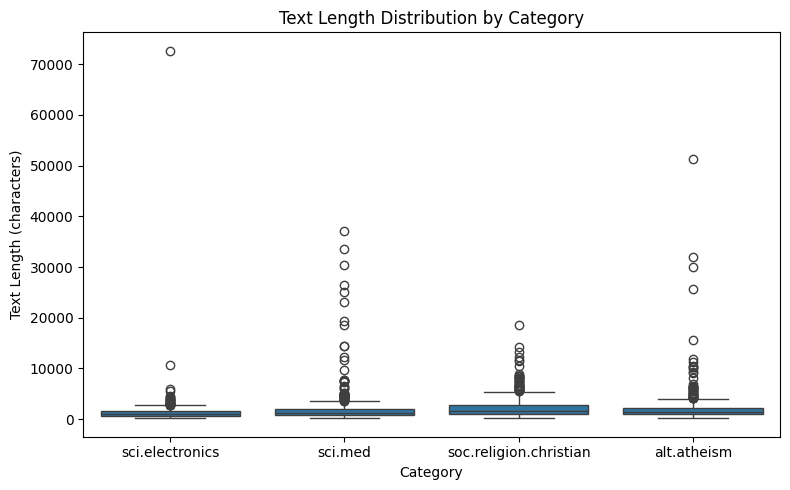
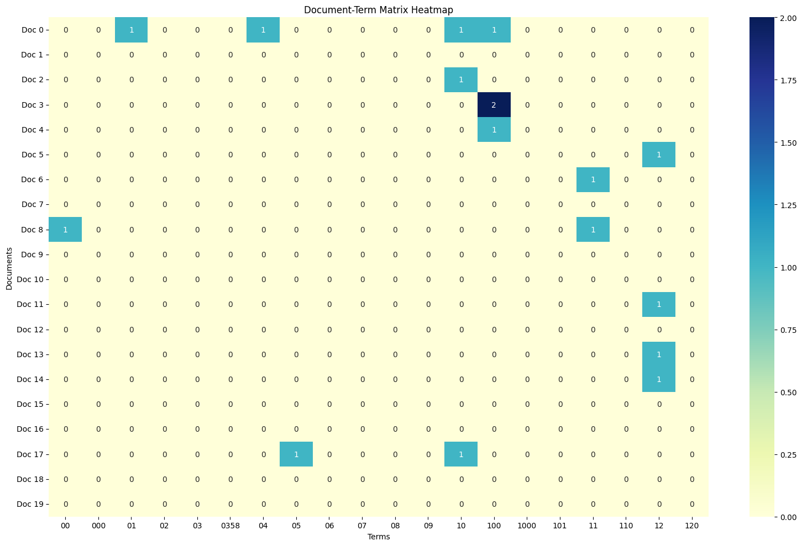
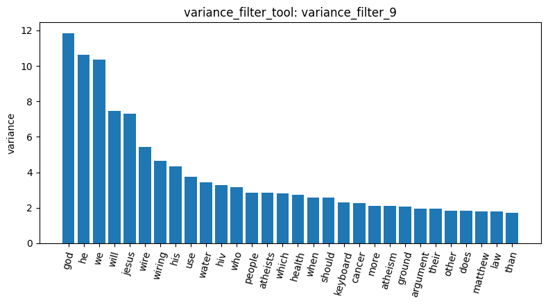
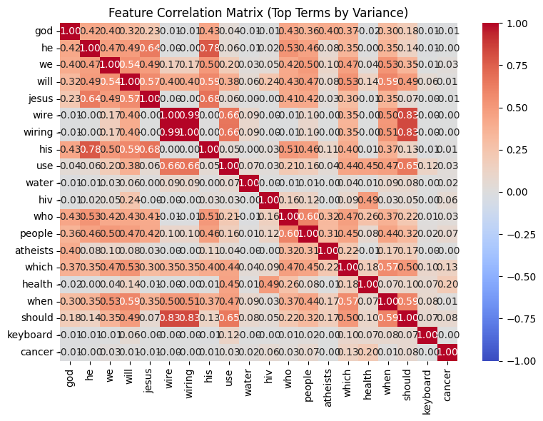
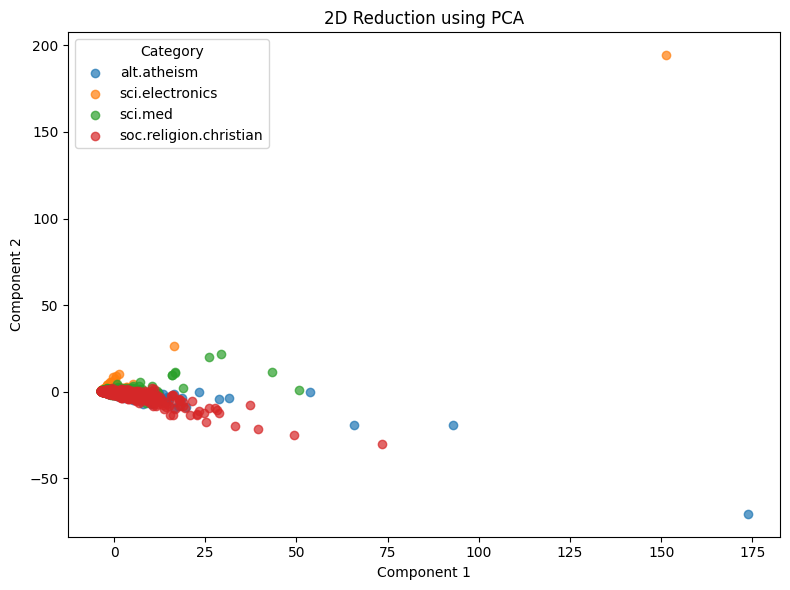
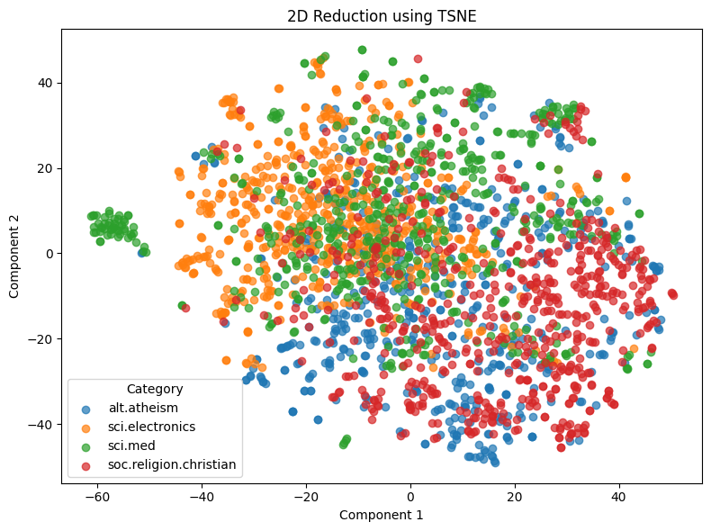
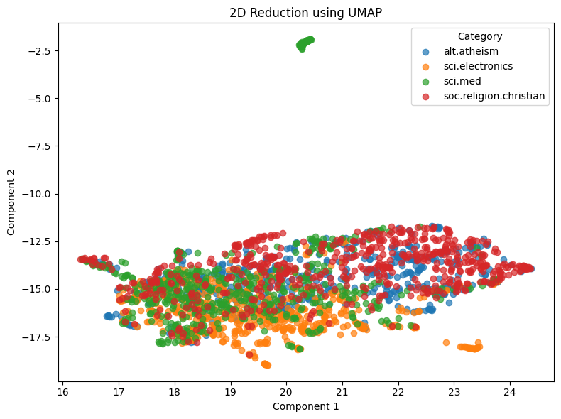

# AgenticPipeline Report: 20-Newsgroups

## 1. Data and Research Question

In AgenticPipeline, I chose four categories from 20-newsgroups: alt.atheism, soc.religion.christian, sci.electronics, and sci.med. I chose them as two pairs, a religion pair and a science pair, because I want to compare how well the categories within each pair can be distinguished from each other.

load_dataset_1 shows that alt.atheism has 480 documents, fewer than soc.religion.christian (599), sci.electronics (591), and sci.med (594). check_missing_3 and check_duplicates_4 found no missing text and no duplicate documents. inspect_data_2 shows that every document begins with an email header (From:, Subject:, Organization:), and I think these headers will become noise in the later analysis. describe_data_5 reports document lengths in characters: the shortest document has only 171 characters, so it has very little content, but it still seems to contain some body text beyond the header.

## 2. Document-Term Matrix and Term Frequency

I skipped sample_data_tool, because the dataset is not very large and sampling would leave even fewer alt.atheism documents. 

For build_dtm_6, I chose max_df=0.35, min_df=3, max_features=5000, and ngram_range=[1, 1]. max_df removes terms that appear in more than a given proportion of documents, so max_df=0.35 removes any term that appears in more than 35% of the documents. I chose 0.35 because, in an earlier session that was interrupted, max_df=0.5 still left header-related words such as com and article among the top terms. The resulting matrix has 2,264 documents and 5,000 terms, with a sparsity of 97.98%. In term_freq_7, the header words no longer appear in the top 30 terms, because max_df=0.35 removed them. However, many stopwords remain, because this is the limit of what max_df can do, and build_dtm_tool has no stop_words parameter.

In dtm_heatmap_8, only 16 of the 400 cells are non-zero, so this slice is 96.0% sparse, close to the overall 97.98% from build_dtm_6. All of the first 20 terms are numbers, because the vocabulary is sorted alphabetically and the tool can only show the top-left corner of the matrix.

## 3. Feature Filtering and Correlation

In variance_filter_9 (threshold 0.01), 671 terms were flagged and 4,329 were kept. Electronics terms such as 120vac and 32bis were flagged as low variance, even though they could help distinguish the science categories, because the variance filter can’t see category labels. After plotting the top terms, words from all four categories appear, unlike term_freq_7, where no science terms made the top 30.

I then ran Pearson and Spearman correlation filters on alt.atheism with a threshold of 0.05. In pearson_filter_10, most of the top terms are people’s names and email host names rather than content words. For example, keith comes from Keith M. Ryan in inspect_data_2 (Index 10), an alt.atheism post. In spearman_filter_11, more content words such as atheists and atheism appear, but the names do not disappear. This is likely because a person’s name appears consistently in their own posts, and Spearman, which uses ranks instead of raw counts, does not weaken this kind of signal. In contrast, the top 10 terms in spearman_filter_12 for sci.electronics are almost all content words, which suggests that sci.electronics is distinguished mainly by its content.

In feature_corr_13, wire and wiring correlate at 0.99, and both also correlate with should at about 0.83. However, neither wire nor wiring is in the top 10 of spearman_filter_12. The explanation I accepted is that these words appear intensely in only a small number of sci.electronics posts. This makes them change together across documents, but it also means their correlation with the whole category stays low. However, the existing tools can’t show how many documents are involved, so this explanation can’t be verified.

## 4. Frequent Pattern Mining

I ran mine_patterns_tool on alt.atheism three times. The tool requires min_sup to be at least 20% of the category’s documents (96 for alt.atheism), so I tried min_sup=120 (25%) as a starting point.

| Result id| Filtering | Algorithm | Result |
| --- | --- | --- | --- |
| `mine_patterns_14` | `tfidf` | `fpgrowth`, `min_sup=120` | 803 patterns; top 10 are all header words |
| `mine_patterns_15` | `term_frequency` | `fpgrowth`, `min_sup=120` | 0 patterns |
| `mine_patterns_16` | `term_frequency` | `topk`, `k=20` | highest support only 25 |

In mine_patterns_14, header words such as lines and subject appear in all 480 documents, so they dominate the patterns. This is because the tfidf filter removes rare terms, not common ones. In mine_patterns_15, the term_frequency filter removes the most frequent terms, and none of the remaining terms appear in at least 120 documents, so no patterns were found. I then switched to topk, which doesn’t use min_sup, but the top patterns in mine_patterns_16 were scattered single words with a support of only 24–25. Overall, tfidf filtering kept the header words, while term_frequency filtering left only scattered words, so pattern mining didn’t find clear topic patterns here.

## 5. Dimension Reduction and Document Similarity

In reduction_17, I used PCA with random_state=42. The two components explain 28.91% and 12.53% of the variance (41.44% in total), but the plot doesn’t show the categories clearly: only a few outlier documents are spread out, while most documents are crowded together near the origin.

Next, in reduction_18, I used t-SNE with random_state=42 and perplexity=30. The result is better than PCA. The religion and science categories are roughly separated. Within the religion pair, the two categories almost completely overlap, while the science pair is slightly more separated.

Finally, in reduction_19, I used UMAP with random_state=42 and n_neighbors=15 to see whether it shows the same pattern. The result is consistent with reduction_18: the two religion categories still overlap, while the science categories are slightly separated, although overall UMAP separates the groups less clearly than t-SNE.

In binarize_labels_20, the category labels were one-hot encoded, and the document counts match load_dataset_1.

Finally, I compared two pairs of documents with cosine similarity. In cosine_22, Doc 10 (alt.atheism) and Doc 12 (soc.religion.christian), a cross-category religion pair, have a similarity of 0.1467. This is higher than cosine_21, where Doc 3 and Doc 19, two sci.med posts in the same thread, have a similarity of only 0.0704. This is consistent with the religion pair being hard to separate in reduction_18 and reduction_19. However, these are only two examples, so this supports the conclusion rather than proving it.

## Conclusion

Overall, the religion and science categories are not hard to separate: they are roughly separated in the t-SNE plot (reduction_18). However, the religion pair is harder to separate than the science pair. In both reduction_18 and reduction_19, the two religion categories almost completely overlap, while the science categories are slightly separated. The cosine similarity results also support this: two posts from different religion categories (cosine_22, 0.1467) are more similar than two posts from the same sci.med thread (cosine_21, 0.0704).

This analysis has some limitations. Header words and people’s names affected the filter results, for example the names and host names in pearson_filter_10 and spearman_filter_11, and many common words (stopwords) remain in the document-term matrix (term_freq_7). The existing tools can’t remove either of them, so they may also affect the dimension reduction and similarity results.

## AI use

The key points and conclusions of this report were written by me in Chinese. AI was used to help translate them into English.
