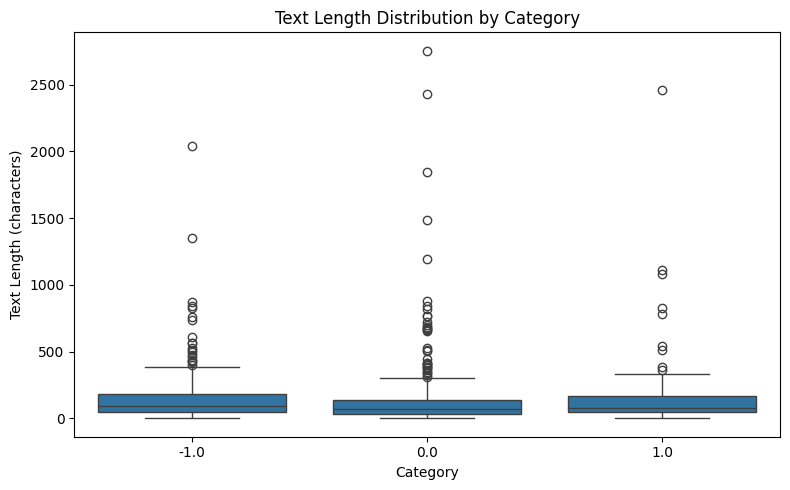
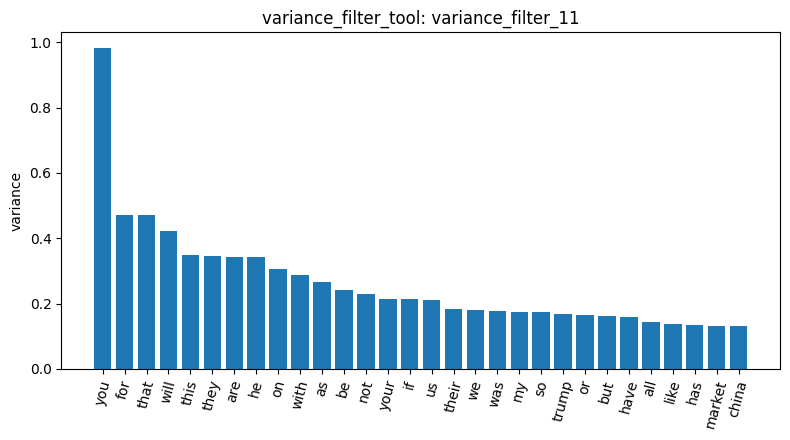
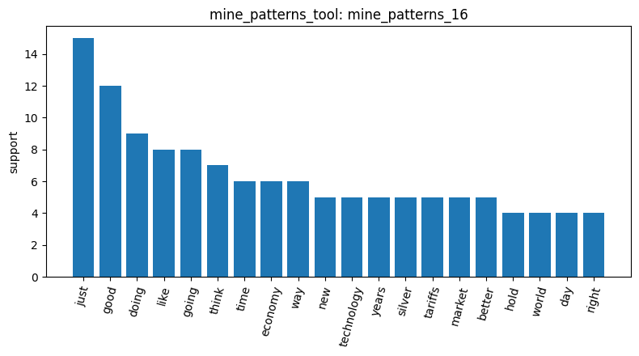
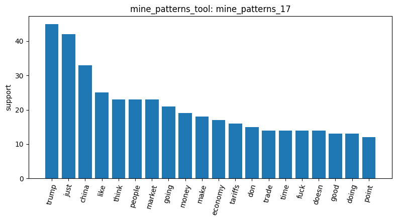
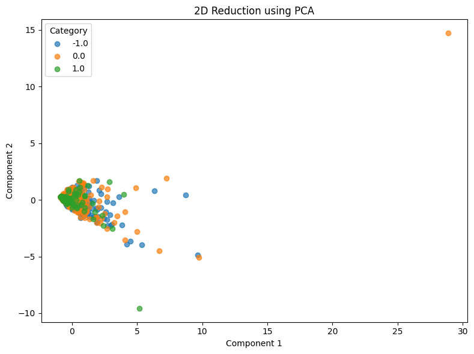
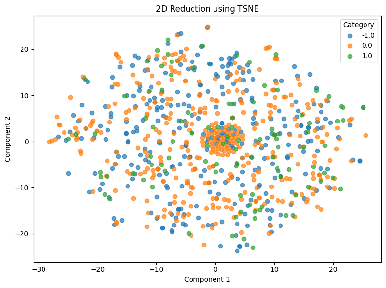
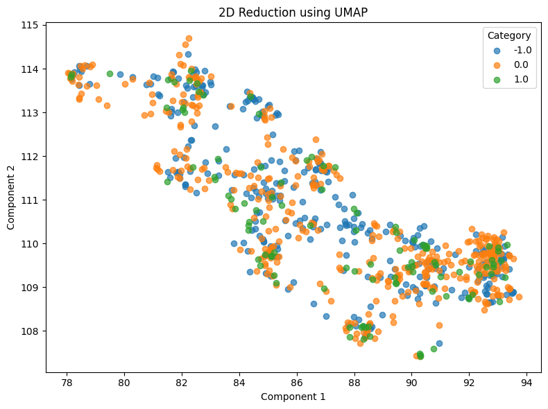

# Homework Report: Sentiment Word Analysis on Reddit

## 1. Research question and dataset

In this homework, I want to find out which words are associated with negative sentiment and which with positive sentiment.

According to `load_dataset_1`, the documents have three sentiment labels: 0.0 (neutral) with 423 documents, -1.0 (negative) with 315 documents, and 1.0 (positive) with 109 documents. The positive class is clearly smaller than the other two.

## 2. Data cleaning and exploration

`inspect_data_2` showed that some of the documents are very short, which can make the document-term matrix (DTM) extremely sparse. `check_missing_3` found no missing data. `check_duplicates_4` found 23 extra duplicate copies, with 34 rows in total belonging to duplicate groups. After discussing with the agent, I decided to remove them with `check_duplicates_5`. Dropping removes all 34 rows, not only the 23 extra copies, but this is a small proportion of the data, so I considered it acceptable, because the duplicates would affect the results of my analysis. After dropping, 813 documents remain.

According to `describe_data_6`, the remaining documents are 315 negative, 391 neutral and 107 positive. Compared with `load_dataset_1`, I noticed that the dropped duplicates are concentrated in the neutral category: neutral lost 32 documents, positive lost 2, and negative lost none. The median text length is 96 characters for negative, 68 for neutral and 81 for positive, so neutral documents tend to be the shortest.

## 3. Building the DTM and the stopword problem

I first built the DTM with `min_df=3` and `max_df=0.3` (`build_dtm_7`), to exclude terms that appear in too few documents and terms that appear in too many documents. This gave 1,044 terms. However, `term_freq_8` showed that almost all of the top 30 terms were stopwords, such as `is` (386), `it` (338), `of` (299) and `in` (278). I therefore lowered `max_df` to 0.2 while keeping `min_df=3`, and rebuilt the DTM (`build_dtm_9`). This only reduced the vocabulary from 1,044 to 1,040 terms: the four removed terms were exactly `is`, `it`, `of` and `in`. `term_freq_10` showed that the top terms were still stopwords, such as `that` (220), `for` (209) and `this` (209). This shows that `max_df` has limited effect. Lowering it further might still not remove the stopwords, and it would increase the chance of content words being removed.

## 4. Which terms are associated with positive and negative sentiment?

In `variance_filter_11` (threshold 0.01), almost all of the top 30 terms by variance are stopwords. Among them, the variance of "you" is close to 1.0, but in `term_freq_10` "you" has a total count of only 195. This suggests that "you" is highly bursty: it may be repeated many times in a small number of documents (for example, posts that address someone directly many times). Since variance only picks out terms that appear frequently or are repeated many times, and cannot pick out sentiment words, I moved on to Pearson and Spearman correlation with the sentiment labels.

In `pearson_filter_12` and `spearman_filter_14` (target class 1.0, threshold 0.05), some positive sentiment words such as "nice", "perfectly" and "huge" are associated with 1.0. In `pearson_filter_13` and `spearman_filter_15` (target class -1.0, threshold 0.05), -1.0 is associated more with political and economic terms such as "trump", "china", "economy" and "trade". However, the top term for -1.0 is actually the pronoun "he" (0.1762 in Pearson), followed by "his" and "will", rather than a political term, and the only clear sentiment word is "fuck".

Comparing `pearson_filter_12` with `spearman_filter_14`, the values of "technology" (0.1525 → 0.1609), "he" (-0.0520 → -0.0853) and "trump" changed, which suggests they may be repeated within individual documents. Comparing `pearson_filter_13` with `spearman_filter_15`, the r value of "china" dropped (0.1256 in Pearson, out of the Spearman top 10), which suggests it may be used heavily in a small number of documents.

## 5. Frequent terms per class (pattern mining)

I mined frequent patterns for category 1.0 (`mine_patterns_16`) and category -1.0 (`mine_patterns_17`), both using TF-IDF filtering and the Top-K algorithm (k=20). This tool removes English stopwords before mining. In both classes, all 20 patterns are single terms; there are no combinations of terms.

For negative (-1.0), the results are similar to Section 4. The most frequent terms are topic words such as "trump" (support 45) and "china" (support 33), and "economy", "trade" and "fuck" also appear in the top 20. The top 10 contain no clear sentiment words.

For positive (1.0), the results are not similar to Section 4. The sentiment words with the highest correlation in Section 4, "nice", "perfectly" and "huge", do not appear in the top 20 of `mine_patterns_16`. Only "technology" appears, with a support of 5.

## 6. Dimensionality reduction

I reduced the DTM to 2D with three methods. In PCA (`reduction_18`), the two components explain only 19.47% and 6.90% of the variance; most points are packed together, with one far outlier. In t-SNE (`reduction_19`), the points are spread evenly, with a dense group in the centre. In UMAP (`reduction_20`), several small clusters appear, but each cluster mixes all three classes. Based on `reduction_18`, `reduction_19` and `reduction_20`, none of the three methods can separate the sentiment classes.

PCA, t-SNE and UMAP are unsupervised, so they do not use the sentiment labels. The short texts and the very sparse DTM (98.7% sparsity) leave little word overlap between documents, and a bag-of-words DTM only counts words without capturing meaning. A further reason is a limitation of my tool: `reduce_dimensions_tool` only uses the 100 terms with the highest variance, and `variance_filter_11` showed that these are mostly stopwords. Terms associated with sentiment tend to have lower variance because they appear in fewer documents, so they are left out of the reduction. This matches Section 5, where "nice", "perfectly" and "huge" have high correlation but low support.

## 7. Conclusion and limitations

To answer the research question in Section 1: the results of `pearson_filter_12` / `pearson_filter_13` and `spearman_filter_14` / `spearman_filter_15` show that some positive sentiment words appear in 1.0, while -1.0 is associated more with political and economic terms. However, both parts of this answer need caution. The positive sentiment words may not be representative: "nice", "perfectly" and "huge" have high correlation but low support (Section 5), and "huge", "main" and "tldr" share exactly the same r value, so they may come from only a few documents (Section 4). The negative side is not only political and economic terms either: its top term is the pronoun "he", and the only clear sentiment word is "fuck" (Section 4). Finally, none of the three dimensionality reduction methods can separate the three classes (Section 6).

This analysis has three limitations. First, `build_dtm_tool` has no stop_words parameter, so stopwords can only be reduced through `max_df`, which had limited effect (Section 3). Second, both variance filtering and dimensionality reduction favour stopwords, because the highest-variance terms are mostly stopwords (Sections 4 and 6). Third, my tools cannot look up specific documents, so explanations such as "a term is repeated many times in a few documents" could not be verified.

## AI use

The key points and conclusions of this report were written by me in Chinese. AI was used to help translate them into English.
